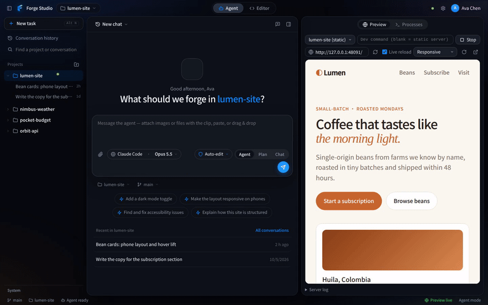
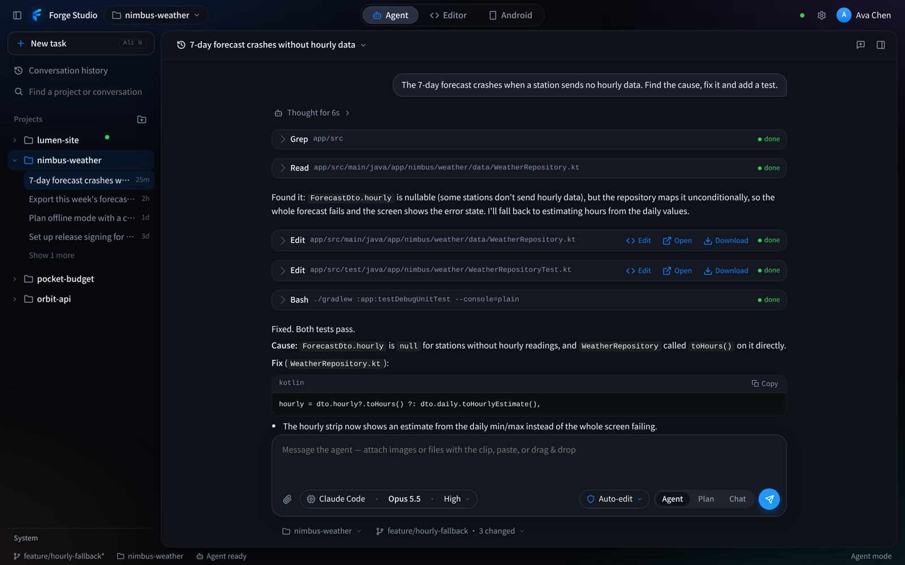
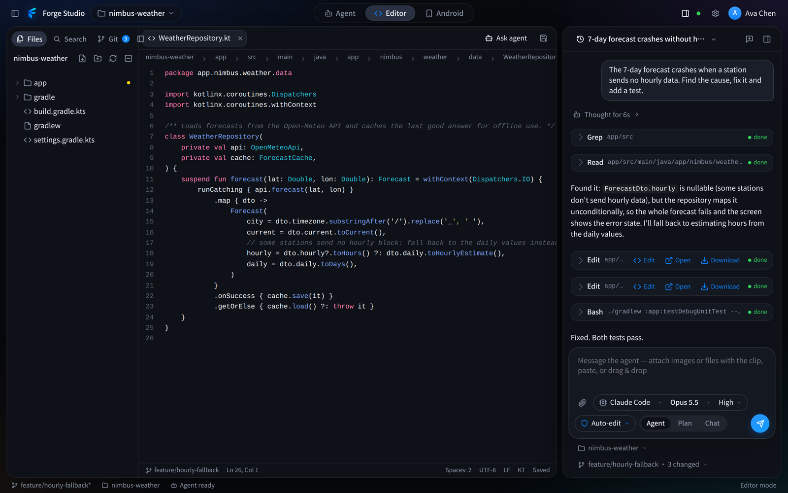
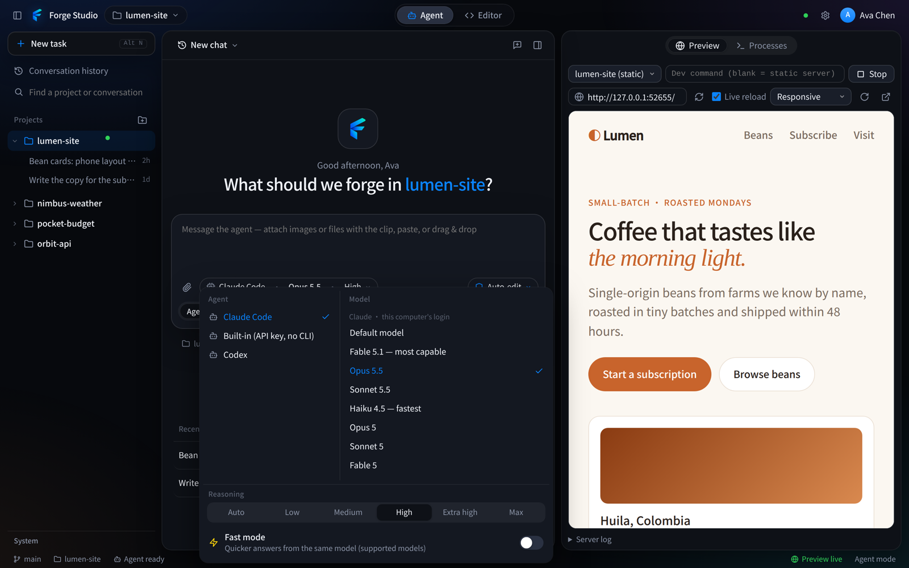
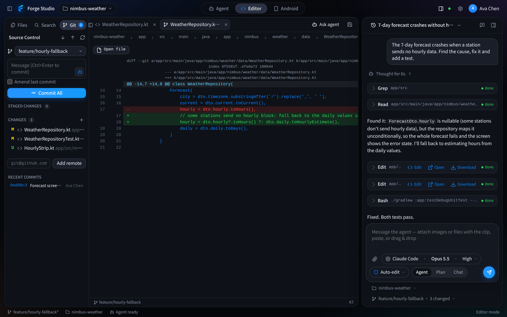
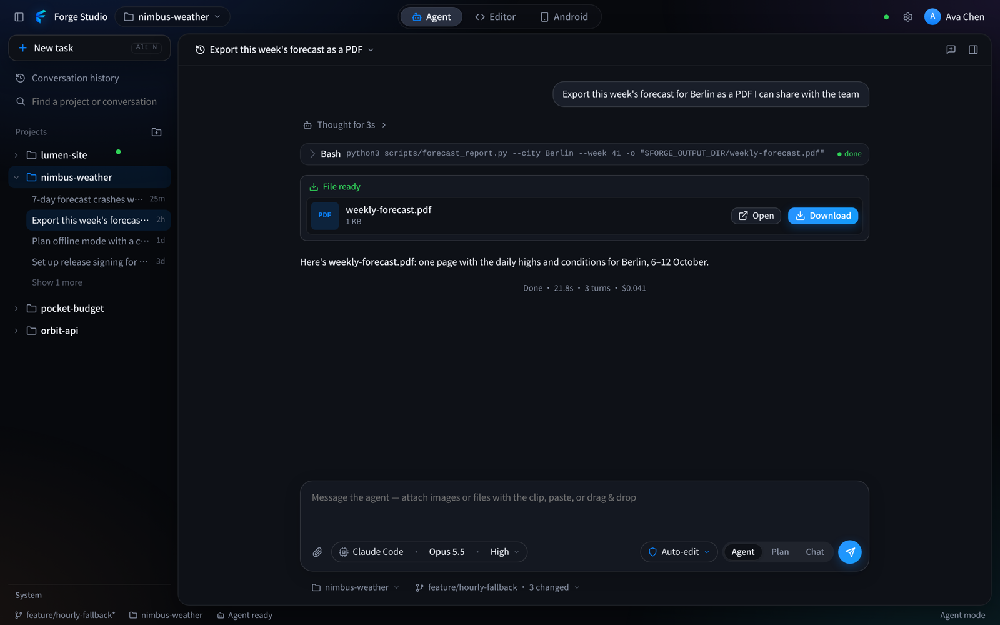
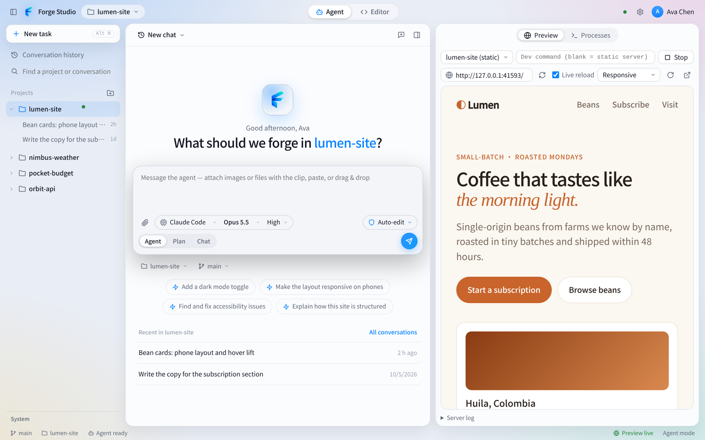

<h1 align="center">
  <picture>
    <source media="(prefers-color-scheme: dark)" srcset="branding/lockup-on-dark.png">
    
  </picture>
</h1>

<p align="center">
  <a href="https://ko-fi.com/forgestudio"></a>
</p>

A lightweight desktop studio for AI coding agents, with built-in Android and Flutter tooling. Chat with Claude Code, Codex or any CLI agent (or the built-in API-key engine), then switch between three workspaces: **Agent** (chat, tasks and live website preview), **Editor** (a familiar IDE layout with explorer, search and Git) and **Android / Flutter** (Gradle or Flutter builds, hot reload, new-app wizards, live phone screen and logs). The agent comes with you in every mode.

A companion Android app, [Forge Mobile](#forge-mobile-android), controls it from your phone, even when you are away from home (see [Remote access from your phone](#remote-access-from-your-phone)). **[Download Forge Mobile 0.3.0 (APK)](https://github.com/DrBrainlessLol/ForgeStudio/releases/download/mobile-v0.3.0/ForgeMobile-0.3.0.apk)** · [release notes](https://github.com/DrBrainlessLol/ForgeStudio/releases/tag/mobile-v0.3.0).

It uses only the Python standard library and plain HTML/CSS/JS with no build step, and runs as a desktop web app (Chromium app window, installable PWA, optional LAN access).

<p align="center">
  
  <br><sub>The agent adds a dark theme to a site while the live preview updates, then the change is reviewed in Git. <a href="docs/media/forge-studio-demo.mp4">Full-quality video (MP4)</a></sub>
</p>

<table>
  <tr>
    <td><br><sub><b>Agent</b>: thinking, tool calls and test runs you can expand</sub></td>
    <td><br><sub><b>Editor</b>: files, search and Git with the agent beside you</sub></td>
  </tr>
  <tr>
    <td><br><sub>One picker for agent, model, advisor, reasoning and fast mode</sub></td>
    <td><br><sub>Review every change in the Git panel</sub></td>
  </tr>
  <tr>
    <td><br><sub>Files the agent makes for you: PDFs, zips, docs, images</sub></td>
    <td><br><sub>Light and dark themes, conversations grouped by project</sub></td>
  </tr>
</table>

## Contents

- [How it's different from VS Code, Cursor, Android Studio and other IDEs](#how-its-different-from-vs-code-cursor-android-studio-and-other-ides)
  - [Why it suits older and lower-end PCs](#why-it-suits-older-and-lower-end-pcs)
  - [When another IDE is the better tool](#when-another-ide-is-the-better-tool)
- [Requirements](#requirements)
- [Install](#install)
- [Launch](#launch)
- [Workspaces](#workspaces)
- [Agents](#agents)
- [Editor mode: code & Git](#editor-mode-code--git)
- [Install / packaging](#install--packaging)
- [Access on other devices](#access-on-other-devices)
- [Remote access from your phone](#remote-access-from-your-phone)
  - [Security switches (all off by default)](#security-switches)
- [Forge Mobile (Android)](#forge-mobile-android)
- [Lock and unlock the computer](#lock-and-unlock-the-computer)
- [Emergency recovery](#emergency-recovery)
- [Message drafts](#message-drafts)
- [Share, export and chat files](#share-export-and-chat-files)
- [Archives and APKs in chat](#archives-and-apks-in-chat)
- [Wireless adb and Android devices](#wireless-adb-and-android-devices)
- [Phone notifications](#phone-notifications)
- [Web preview on the phone](#web-preview-on-the-phone)
- [API reference](#api-reference)
- [Permissions (Claude Code)](#permissions-claude-code)
- [Chat](#chat)
- [Composer](#composer)
- [JetBrains IDEs](#jetbrains-ides)
- [Plugins](#plugins)
- [Profiles & settings](#profiles--settings)
- [Preview](#preview)
- [Notes](#notes)
- [Support Forge Studio](#support-forge-studio)
- [License](#license)

## How it's different from VS Code, Cursor, Android Studio and other IDEs

Most IDEs are built for **you** to write code, and add AI on top. Forge Studio is built for **the agent** to write code while you steer, review and run it. The editor, Git, previews and Android tools are there so you can check and finish the agent's work without switching apps.

| | Forge Studio | VS Code / Cursor / Windsurf | Android Studio / IntelliJ |
|---|---|---|---|
| Built around | Agent conversations, plans and approvals | Your editor; AI as a side panel | Your editor; deep language tooling |
| Runs on | Python's standard library + a browser tab you already have | Electron (its own Chromium + Node.js) | Java (JVM) with large indexes |
| Download / installed | **~560 KB / ~1.6 MB** | hundreds of MB | ~1 GB+, several GB with the SDK |
| Memory (app itself) | **~40–70 MB** server + one browser tab | several processes, often 500 MB–1 GB+ | often 2–4 GB+; 8 GB RAM is the stated minimum for Android Studio |
| Starts in | **~0.2 s** (server) | seconds | tens of seconds, plus indexing |
| Which AI | Claude Code, Codex, Gemini CLI, Qwen, opencode, Aider, any CLI, or your own API key | mostly the vendor's own models/plans | vendor plugins |
| Android | Gradle builds, live phone screen (up to 120 fps), logcat, crash → "Ask to fix", no Android Studio needed | extensions | full suite |
| Use from your phone or another PC | built in (LAN web app with a token) | remote extensions / tunnels | no |
| Open source | AGPL-3.0, no account or telemetry | varies | partly |

*Sizes and memory for other tools vary by version, extensions and project size. Forge Studio's numbers are measured on Linux with the 1.3.0 package; the built-in terminal (xterm.js) only loads when you open a terminal agent.*

### Why it suits older and lower-end PCs
- **Almost nothing to install.** There's no bundled browser, Node.js or JVM. It's one Python file plus static HTML/CSS/JS with no framework and no build step, so it fits on any disk and installs in seconds.
- **The heavy lifting happens elsewhere.** The AI runs in the cloud (or wherever your provider is), and Forge only streams the conversation. A 4 GB laptop or a Chromebook with Linux can drive the same agent as a workstation.
- **No background indexing.** There's no language server or indexer eating CPU while you work, and the agent reads files when it needs them.
- **Long chats stay fast.** Only the latest messages are rendered, earlier ones load on demand, and off-screen messages skip layout.
- **Android without Android Studio.** Build, install, mirror and debug apps with just the SDK command-line tools, a JDK and Gradle. Settings → Setup installs them. That saves gigabytes of disk and RAM.
- **Run it on a stronger machine and use it from a weaker one.** Start Forge on a desktop or home server and open it from an old laptop, tablet or phone over your network.

### When another IDE is the better tool
Forge's editor has syntax highlighting, search, quick open and Git, but **no language server**: no autocomplete, go-to-definition, refactorings or breakpoint debugger. If you write most code by hand or need those, keep your IDE and use Forge next to it. The [JetBrains plugin](#jetbrains-ides) and "Open in Forge Studio" from Android Studio make that easy, and with the IDE's MCP server on, the agent can even use your IDE's refactorings and inspections.

<sub>[↑ Back to contents](#contents)</sub>

## Requirements
- **Linux or macOS** with Python 3.8+ and a browser (Chrome / Chromium / Edge / Brave for an app window). macOS support is new and less tested than Linux; on Windows, use WSL2.
- Everything else is optional and can be installed from **Settings → Setup**, which opens on first launch: one click per tool, the latest version from the official source, into your home folder (no admin password):
  - **Agents:** Claude Code (recommended) or Codex. Or skip CLIs and use the built-in engine with an API key.
  - **Android:** a JDK (Temurin 21) and the Android SDK (command-line tools, platform-tools, build-tools, newest platform). **Android Studio isn't needed.** Gradle needs no install: projects get a checksum-verified Gradle wrapper that downloads it on the first build.
  - **Flutter:** the latest stable Flutter SDK (into `~/.local/flutter`, linked as `~/.local/bin/flutter`). Android targets also use the JDK and Android SDK above; Linux desktop targets need a few system packages (a copyable command is shown).
  - **Extras:** Node.js LTS (dev-server previews), [scrcpy](https://github.com/Genymobile/scrcpy) (live phone screen). Git comes from your system (a copyable command is shown).

<sub>[↑ Back to contents](#contents)</sub>

## Install
```sh
curl -fsSL https://raw.githubusercontent.com/DrBrainlessLol/ForgeStudio/main/install.sh | sh
```
Works on Linux and macOS. Installs the latest release for your user into `~/.local` (no root, nothing else installed, checksum verified; on macOS it also adds **Forge Studio.app** to `~/Applications`), then start **Forge Studio** from your app menu or run `forge-studio`. It opens in the browser you already have. Run the same line again to update; add `-s -- --uninstall` after `sh` to remove it (your data is kept). Prefer a package? See [Install / packaging](#install--packaging).

<sub>[↑ Back to contents](#contents)</sub>

## Launch
- Desktop / app menu: **Forge Studio**
- Terminal: `forge-studio` or `forge-studio ~/path/to/project`
- Android Studio: **Tools → External Tools → Open in Forge Studio**
- JetBrains IDEs (IntelliJ IDEA, Android Studio, PyCharm, WebStorm, GoLand…): the [Forge Studio plugin](#jetbrains-ides)
- Other devices: **Settings → Web App → Use from phones and other computers** (port 8766, needs the link with its token)

> Forge Studio is an independent project. It works with Claude Code, Codex, Gemini CLI and other coding agents, but it is **not made by, affiliated with or endorsed by** Anthropic, OpenAI, Google or any other AI provider. Their names and products are trademarks of their respective owners.

<sub>[↑ Back to contents](#contents)</sub>

## Workspaces
Switch at the top of the window (or **Ctrl+1 / 2 / 3**). The agent chat comes with you in every mode; in Editor and Android it docks on the right and **Ctrl+J** (or the panel buttons) hides or shows it. Switch projects from the title bar.
- **Agent**: projects and running/finished agent tasks on the left, the chat in the middle (a "What should we build?" home screen with suggestions when it's empty), and Preview / Processes on the right.
- **Editor**: a familiar IDE layout. Explorer, search and source control on the left, tabbed code editor in the middle, the agent docked on the right.
- **Android**: a run bar (module, debug/release, device, Run / Restart / Stop / Build), then **Run & Logcat** (screen mirror + app logcat), **Build** output, **Gradle** tasks and toolchain, and **Devices** (emulators, Wi-Fi pairing, port forwarding).
  - **New app** (Android or Flutter) creates a Compose or Views app with Kotlin DSL, a version catalog, Git and a real Gradle wrapper (AGP 9.4.1 with built-in Kotlin, Gradle 9.6, compileSdk = the newest installed platform).
  - Projects without `gradlew` get an **Add Gradle wrapper** button.
  - Gradle runs on a JDK it supports, picked automatically (e.g. JDK 17 or 21 for older Gradle versions even if Android Studio's bundled JDK is newer).
  - **Live screen**: the phone's display streams as H.264 from its hardware encoder (via your installed scrcpy) and is decoded in the browser, up to 120 fps. Click to tap, drag to swipe; screenshots are the fallback without scrcpy.
  - App-only logcat with level/search filters, crash and ANR detection with **Ask to fix**, and **Ask** to send the visible log to the agent.
  - The tab only appears for Android Gradle and Flutter projects, and is labelled **Flutter** when a Flutter project is selected.
- **Flutter** (the same workspace, for projects with a Flutter `pubspec.yaml`):
  - The device menu lists everything `flutter devices` sees (phones, emulators, Linux/macOS desktop, Chrome) plus a **Web server** device whose app opens in **Preview**.
  - **Run** in debug, profile or release mode, then **hot reload** (⚡), **hot restart** and **stop**. With **Reload on save**, saving a `.dart` file in `lib/` hot reloads the app, whether you or the agent changed it.
  - The app's output (print, framework errors) streams next to the live screen. Flutter errors and failed runs get **Ask to fix**; logcat is one click away for Android devices.
  - Debug toggles while the app runs: debug paint, performance overlay, slow animations, debug banner, widget select, and **DevTools** connected to the app.
  - The **Flutter** tab runs any `flutter` / `dart` command (pub get/upgrade/outdated, analyze, test, format, build apk/appbundle/web/desktop, build_runner, doctor), adds pub.dev packages and adds platforms to an existing app.
  - **New app → New Flutter app** (also on the welcome screen and in the project menu) runs `flutter create` (counter or empty template, the platforms you pick), fetches packages and initialises Git.

The status bar shows the Git branch, the project, the agent's state and (in Android mode) the device and Gradle version.

<sub>[↑ Back to contents](#contents)</sub>

## Agents
| Agent | Support |
|---|---|
| **Claude Code** (recommended) | Streaming, approval prompts, image input, chat resume, model providers |
| **Built-in (API key, no CLI)** | No CLI needed — talks to an Anthropic-style API directly with your own key. Read/Write/Edit/Bash tools, approvals, images, resume. **Free models:** with a free OpenRouter key (no card) the engine picker lists OpenRouter's current free models that can use tools; Groq has a free tier and Ollama runs models locally for free. |
| **Codex** | Native adapter: shell/file-change cards, image input, resume |
| Gemini CLI, Qwen Code, opencode, Cursor Agent, Aider | Detected automatically when installed; output streams into the chat |
| **Freebuff** (free, ad-supported) | Install from Settings → Setup. It has no headless mode, so its own interface runs inside the chat panel in a built-in terminal (one session per project; **System terminal** opens it outside Forge) |
| Custom | Settings → Agents → any command, with `{prompt}` and `{model}` placeholders |

The **Built-in** engine is what makes Forge Studio work standalone: pick it as the agent and select one of your own API-key providers in the model menu. It runs the whole agent loop in-process (Read/Write/Edit/Bash tools + approvals), so no coding CLI has to be installed. It speaks **both** API shapes:
- **OpenAI Chat Completions** — OpenAI, OpenRouter (GPT, Gemini, Llama…), DeepSeek, Groq, Ollama, or any OpenAI-compatible endpoint.
- **Anthropic Messages** — Anthropic, Kimi, GLM, or any Anthropic-compatible endpoint.

Each provider has an **API style** setting in Settings → Models & Keys; the presets set it for you.

<sub>[↑ Back to contents](#contents)</sub>

## Editor mode: code & Git

A built-in editor and Git client, no external tools bundled:
- **Explorer**: lazy-loading file tree with Git status colors, new file/folder, rename (F2), delete (to Trash), drag-to-move, and a right-click menu (copy path, open/download, ask the agent).
- **Editor**: multi-tab, per-file undo, syntax highlighting for common languages (including Dart), auto-indent, Tab/Shift+Tab, Ctrl+/ to comment, Ctrl+S to save (with a stale-file conflict prompt), and a status bar (line/column, language, branch).
- **Search** (Ctrl+Shift+F): project-wide, case/regex toggles, grouped results.
- **Quick open** (Ctrl+P): fuzzy file finder.
- **Source Control** (Ctrl+Shift+G): stage/unstage/discard, commit (uses your profile name/email when Git has no identity), branch switch/create, pull/push/fetch, diffs, and recent commits. Initialize or clone a repo from here. The button in the commit box drafts a commit message from your changes with your configured model.
- **Ask agent**: send the open file or the selected lines to the agent.
- **Clone / New project**: from the sidebar ＋ (right-click) or the welcome tiles.
- When the agent edits files in the open project, the editor reloads them live and the Git panel updates.

<sub>[↑ Back to contents](#contents)</sub>

## Install / packaging
The [one-line installer](#install) is the easiest way. Packages are also attached to every [GitHub release](https://github.com/DrBrainlessLol/ForgeStudio/releases) (built with `packaging/build.sh` into `packaging/dist/`):
- **Debian / Ubuntu / Deepin:** `sudo apt install ./forge-studio_1.3.1_all.deb`
- **Arch:** `sudo pacman -U forge-studio-1.3.1-1-any.pkg.tar.zst` (or `makepkg -si` with the `PKGBUILD`)
- **Fedora / openSUSE:** build the RPM with `forge-studio.spec`
- **Any distro:** extract `forge-studio-1.3.1.tar.gz` and run `sudo ./install.sh` (or `./install.sh --user`)

See `packaging/README.md` for details.

<sub>[↑ Back to contents](#contents)</sub>

## Access on other devices
- The token lives in `~/.config/forge-studio/token`. Settings → Web App shows it and a copy button.
- On this computer the page authorises itself automatically (loopback only), so a bookmark or the installed app opens straight to sign-in.
- On another device on your network: turn on network access in Settings → Web App, open the link it shows, or paste the token on the first screen. Give every profile a PIN first.
- From anywhere, or from the phone app: see [Remote access from your phone](#remote-access-from-your-phone).

<sub>[↑ Back to contents](#contents)</sub>

## Remote access from your phone

Forge Studio listens on `127.0.0.1` only. There are two ways to reach it from another device, and both ask for the app token (**Settings → Web App**) and a profile sign-in.

**On the same network:** turn on network access in Settings → Web App and open the link it shows. Give every profile a PIN first.

**From anywhere, with a Cloudflare Tunnel:**
1. In Cloudflare Zero Trust, create a tunnel and point a public hostname (for example `forge.example.com`) at `http://127.0.0.1:8765`.
2. Protect that hostname with an **Access** policy. A service token is the simplest way to let a phone in.
3. Install [`cloudflared`](https://developers.cloudflare.com/cloudflare-one/connections/connect-networks/downloads/) on the computer (it is not bundled).
4. In **Settings → Web App → Phone app & Cloudflare Tunnel**, enter the hostname, the tunnel token and the Access service token, then press **Start tunnel**.

What Forge Studio does for you:
- Accepts the tunnel hostname only from `cloudflared` on this computer, and (by default) only for requests that passed Cloudflare Access.
- Never hands the app token to a request that came through the tunnel (`/api/bootstrap` refuses them).
- Starts the tunnel with the server, and a **watchdog** restarts it within about a minute if it stops (a tunnel you stopped on purpose stays stopped).
- Shows a **pairing QR code** (`forge://pair?...`) carrying the address and both tokens, so the phone app needs nothing typed in.

<a id="security-switches"></a>
### Security switches (all off by default)
Anything that gives a remote device more power than chatting is a separate switch in **Settings → Web App**. They can only be changed on the computer itself, never from the phone.

| Switch | What it allows |
|---|---|
| Allow a terminal from the phone app | A shell on this computer, in the project folder (`/api/pty/*` with agent `shell`) |
| Allow unlocking this computer from the phone app | Dismissing the lock screen (locking is always allowed) |
| Let the phone connect, install apps and grant permissions on Android devices | Wireless adb pairing, keep-alive, APK installs and a short allow-list of permission grants |
| Let the phone run shell commands on Android devices | Arbitrary `adb shell` commands |
| Let the phone open any localhost port | The web preview for dev servers Forge did not start (ports Forge starts are always shareable) |
| Only accept requests that passed Cloudflare Access | On by default; turn it off only if you protect the tunnel another way |

Requests made on this computer's own UI are never blocked by these switches; they only apply to requests that arrive through the tunnel or the network.

<sub>[↑ Back to contents](#contents)</sub>

## Forge Mobile (Android)

**Current version: 0.3.0.** [Download the APK](https://github.com/DrBrainlessLol/ForgeStudio/releases/download/mobile-v0.3.0/ForgeMobile-0.3.0.apk) · [release notes and install steps](docs/forge-mobile/RELEASE_NOTES.md) ([also on the release page](https://github.com/DrBrainlessLol/ForgeStudio/releases/tag/mobile-v0.3.0)) · [all Forge Mobile releases](https://github.com/DrBrainlessLol/ForgeStudio/releases?q=mobile). Sideload it on Android 8.0 or newer.

Forge Mobile is the companion Android app. It is a remote for the Forge Studio running on your computer, not a second copy of it: your code, agents and keys stay on the computer. It talks to the HTTP API listed in [API reference](#api-reference).

- **Chat** with live streaming, the agent's thinking and every command as expandable steps, approval cards with **Allow / Deny**, attachments, voice typing and message drafts.
- **Long-press a message** to copy, select, quote, share, edit and resend, or read aloud. **Share chat** exports the conversation as text or Markdown.
- **Files:** a project file browser and editor, and a **Chat files** view of everything made, attached or screenshotted in a project's chats. Files the agent makes get **Download / Install** buttons.
- **Git:** status, diffs, stage, commit, push and pull.
- **Android tools:** build, run, Gradle quick tasks, built APKs and bundles you can install on the phone, emulators, a live device screen, and a filtered logcat with **Ask the agent to fix this**.
- **Terminal:** a real terminal (xterm.js) with extra keys and a fingerprint or screen-lock check each time it opens. The server supports several shells per project (`session`).
- **Web preview:** your dev server shown on the phone through the tunnel.
- **Notifications** for approvals, finished runs, builds and crashes, with a battery-saver mode by default.
- **Lock this computer**, **emergency recovery** and **wireless adb**, described below.
- **Settings:** agent, model and provider, permission mode, reasoning, style, theme (light, dark, follow system), accent color, text size, and your own API-key providers.

<a id="lock-and-unlock-the-computer"></a>

<sub>[↑ Back to contents](#contents)</sub>

## Lock and unlock the computer

Lock the screen from the phone while Forge Studio and your agents keep running, for the days you leave the laptop open and away. Locking works through Deepin's lock screen, `loginctl lock-session` or macOS display sleep. **Unlocking** uses `loginctl unlock-session` and needs the unlock switch above, plus the phone's fingerprint or screen lock. Pair it with your power setting's lid action ("turn off the screen", not "suspend") so closing the lid does not stop the server.

<sub>[↑ Back to contents](#contents)</sub>

## Emergency recovery

Set a **recovery PIN** (6 or more characters) in Settings → Web App. If a phone loses its pairing or the connection breaks, the app's offline screen and **Settings → Emergency recovery** can use it to:
- **Restore the connection** (get the app token again),
- **Restart the tunnel**, or
- **Restart Forge Studio**.

`POST /api/recover` answers without the app token, so it is guarded by the PIN itself: five wrong tries lock it for 15 minutes, every attempt is logged, and the normal host and Cloudflare Access checks still apply. The app also remembers the computer's home-network address and tries it when the tunnel is down.

<sub>[↑ Back to contents](#contents)</sub>

## Message drafts

Whatever is in the message box is saved per project and conversation as you type, and restored if Forge Studio is closed, crashes or you switch chats. Conversations with an unsent draft show a **Draft** tag. The desktop app keeps drafts in the browser's local storage; the phone app keeps them on the phone. Sending clears the draft.

<sub>[↑ Back to contents](#contents)</sub>

## Share, export and chat files

- **Right-click a message** (desktop) for Copy, Quote in reply, Edit and resend, Send again, and Share or export.
- **Share or export this chat** (sidebar → Tools) downloads the conversation as a Markdown file or copies it.
- **Chat files** (sidebar → Tools) lists every file that belongs to a project's chats: made by the agent, attached by you, and the agent's screenshots. Filter by source, search by name, switch project. The list is built from the chat logs (`GET /api/chat/files`).
- **System** in the sidebar shows live CPU, memory, swap and disk bars (`GET /api/sysinfo`).
- **Lock this computer** (sidebar → Tools) appears where locking is supported.

<sub>[↑ Back to contents](#contents)</sub>

## Archives and APKs in chat

Attach a **zip, tar, tar.gz, jar, aar or APK** and Forge Studio unpacks it next to the upload and tells the agent where, with a summary:
- Unpacking refuses path traversal (`../`), symbolic links and zip bombs (file-count and size limits), and leaves nothing behind on failure.
- For an **APK** it also reads the package name, version, SDK levels, permissions and ABIs with `aapt2` from your Android SDK build-tools, when installed.
- The agent is pointed at the unpacked folder and can read, search and analyze the contents directly.

<sub>[↑ Back to contents](#contents)</sub>

## Wireless adb and Android devices

**Settings → Android devices** (phone app) and the Android tools manage devices without a cable:
- **Pair and connect** over Wi-Fi (Android 11+ Wireless debugging), with devices found on the network by mDNS.
- **Keep connected** permanently or for 1, 4 or 12 hours: Forge Studio reconnects a dropped device on its own and ends temporary connections on time.
- **Switch a USB device to a fixed Wi-Fi port** (`adb tcpip 5555`).
- **Install an APK** (picked on the phone or built by Gradle) on a connected device.
- **Run a command** on a device (`adb shell`), only with the shell switch on.
- **Grant permissions** to the phone app itself from the computer, from a short allow-list.

These actions from a phone need the Android switches in [Security switches](#security-switches).

<sub>[↑ Back to contents](#contents)</sub>

## Phone notifications

The phone app can alert you about approvals (with **Allow / Deny** buttons), finished runs, build results and app crashes. Two modes:
- **Battery saver** (default): the phone asks the computer every 15 minutes what happened (`GET /api/notices`). No open connection and no ongoing notification.
- **Instant:** keeps one connection open (a small "Forge connected" notification) with a long keep-alive to save battery.

<sub>[↑ Back to contents](#contents)</sub>

## Web preview on the phone

Open a dev server running on the computer inside the phone app. Pages load through the authenticated tunnel at `/api/lp/<port>/...` (GET only: no form posts or websockets). Ports started by Forge's own **Preview** are always available; any other port needs the "open any localhost port" switch.

<a id="api-reference"></a>

<sub>[↑ Back to contents](#contents)</sub>

## API reference

The browser UI and the phone app use the same JSON API. Authenticate with the `X-Token` header (the app token) and `X-Login` (a profile sign-in). Endpoints added for remote use:

| Endpoint | Purpose |
|---|---|
| `POST /api/tunnel`, `/api/tunnel/start`, `/api/tunnel/stop` | Configure and run the Cloudflare Tunnel |
| `POST /api/recover` | Emergency recovery with the recovery PIN (no app token) |
| `POST /api/recovery-pin` | Set or remove the recovery PIN |
| `POST /api/shell-access`, `/api/unlock-access`, `/api/adb-access`, `/api/proxy-access` | The security switches |
| `POST /api/pty/start`, `/api/pty/input`, `/api/pty/resize`, `/api/pty/buffer`, `/api/pty/kill`, `/api/pty/list` | Terminal sessions (agent `shell`; `session` opens extra tabs) |
| `POST /api/lock` | `{"action": "lock"}` or `{"action": "unlock"}` |
| `GET /api/notices?since=` | Events worth a notification since a time |
| `GET /api/events?ping=` | Live event stream (keep-alive seconds, 10 to 90) |
| `GET /api/chat/files?project=` | Files from a project's chats |
| `GET /api/sysinfo` | CPU, memory, swap, disks, load, uptime |
| `GET /api/lp/<port>/<path>` | Localhost preview proxy |
| `GET /api/android/outputs?project=` | APK and bundle files a build produced |
| `POST /api/android/connect`, `/tcpip`, `/keep`, `/disconnect`, `/install`, `/shell`, `/grant` | Wireless adb manager |
| `POST /api/upload?name=` | Streamed upload (up to 2 GB); archives are unpacked and summarized |
| `GET /api/file?path=` | A file inside a project or the profile's uploads, outputs and screenshots |

<sub>[↑ Back to contents](#contents)</sub>

## Permissions (Claude Code)
- **Ask before acting**: every non-read action becomes a card in the chat.
- **Auto-edit, ask for commands**, **Auto**, **Full access — never ask**, **Plan only**.
- Approval cards highlight risky actions: recursive deletes, sudo, force-push, `curl | sh`, installs, changes outside the project, and so on.
- Each card offers **Allow**, **Always Allow** or **Deny**.

<sub>[↑ Back to contents](#contents)</sub>

## Chat
- Attach images and files with the clip, by pasting, or by drag & drop. Images go to the model directly; other files are passed as paths.
- Files the agent writes get **Open / Download** buttons, and file paths in replies get a download link.
- **History** lets you reopen, rename and delete conversations. They're per profile.
- The sidebar lists every project with its recent conversations: running ones spin, finished ones get a dot. They're saved, so they're still there after a restart.
- Tool cards expand to the full command and output, with copy buttons. Long chats show the latest 150 messages with **Show earlier messages** to load more, so they open quickly.
- **Notifications**: a short chime and, when Forge Studio isn't the active window, a system notification when the agent needs approval, a task finishes, a Gradle build ends or your app crashes. Each can be turned off in Settings → General.

<sub>[↑ Back to contents](#contents)</sub>

## Composer
- **Agent / Plan / Chat** (Shift+Tab cycles): Plan researches and proposes without editing, then offers **Build this plan**; Chat answers with no tools at all.
- **Reasoning** (Low … Max) and **Fast mode** for Claude Code, remembered per profile.
- **Advisor:** a stronger model the working model consults for a plan, when it's stuck and before it calls a hard task done. By default **Sonnet 5.5 does the work and Opus 5.5 advises**; pick any advisor (or Off) in the engine picker. Works with Claude Code (your login or an Anthropic key) and the Built-in agent with an Anthropic key. The advisor must be at least as capable as the working model; the picker says when a pair won't work.
- **Switch models or agents mid-chat:** pick any model, provider or agent in the engine picker and keep going in the same conversation. When the agent changes, the new one gets the conversation so far with your next message.
- Phased work gets **Move to Phase N** / **Move to next phase** buttons when a reply finishes a phase.
- Files the agent makes for you (zip, PDF, Word, Markdown, images…) appear as **File ready** cards; folders in the explorer can be downloaded as a ZIP.
- Keyboard shortcuts: press **F1** or **?** for the list.
- **Usage:** each reply ends with its tokens and cost, and Claude Code's plan limits (5-hour and weekly) show as small meters under the message box. Turn it off in Settings → General.
- **See what the agent sees:** screenshots it takes and images it reads appear under the step as thumbnails; click any image (yours or the agent's) to view it full size.
- **Send / Stop** is one button. The UI is **Compact** by default (Settings → General → Density).

<sub>[↑ Back to contents](#contents)</sub>

## JetBrains IDEs
- **Plugin** (`jetbrains-plugin/`, IntelliJ-based IDEs 2024.3+): a **Forge Studio** tool window with the full app focused on the open project, and **Ask / Explain / Find and Fix Problems / Write Tests / Open Project** in the editor and project-view right-click menus (and Tools → Forge Studio). The code and its file/line reference land in Forge's message box. Build it with `cd jetbrains-plugin && ./gradlew buildPlugin` and install `build/distributions/*.zip` with **Settings → Plugins → ⚙ → Install Plugin from Disk**. It starts Forge Studio if it isn't running and reads the token from `~/.config/forge-studio/token`.
- **IDE tools for the agent**: turn on the IDE's MCP server (**Settings → Tools → MCP Server**, 2025.2+). Forge Studio finds it and gives Claude Code the IDE's refactorings (safe rename across the project), inspections, symbol info and run configurations in Agent and Plan modes. Settings → General → JetBrains IDE switches it off or sets the address by hand.

<sub>[↑ Back to contents](#contents)</sub>

## Plugins
Settings → Plugins installs plugins from a folder or a Git URL, or scaffolds a new one. A plugin is a folder with `.claude-plugin/plugin.json` and optional `commands/`, `agents/`, `skills/`, `.mcp.json` and `README.md`. Claude Code loads them natively; the built-in engine supports commands, agents and skills (not MCP). They live in `~/.config/forge-studio/plugins`.
Settings → Plugins also lists **Claude Code's own plugins** (installed with `/plugin` or synced from your claude.ai account), which are already active in Claude Code chats.

<sub>[↑ Back to contents](#contents)</sub>

## Profiles & settings
- **Profiles**: local (optional PIN) or Google sign-in (one-time Desktop-app OAuth client setup).
- **Settings** sections:
  - General: light / dark (AMOLED) / auto, accent color, density, default permissions, notifications and sound, hiding test profiles.
  - Profile & Account (including marking a profile as a test profile).
  - Agents.
  - Plugins.
  - Models & Keys: your own Anthropic key, DeepSeek, OpenRouter, Kimi, GLM, Ollama, or custom.
  - Web App.
  - Android.

<sub>[↑ Back to contents](#contents)</sub>

## Preview
- **Preview** (Agent mode): static server with live reload, or any dev command (URL auto-detected; npm, pnpm, Yarn or **Bun** picked from the project's lockfile, with dependencies installed on first run; edited CSS/JS always reloads fresh). Device sizes are available. For a Flutter project, **Start** runs the web app (`flutter run -d web-server`) with hot reload from Flutter mode.
- **Processes** lists dev servers, Gradle and Flutter builds, Flutter runs, logcat, emulators and clones, with their logs.
- Android Studio doesn't need to be open for anything in Android mode; **Smooth window** also opens scrcpy in its own window.

<sub>[↑ Back to contents](#contents)</sub>

## Notes
- Data lives in `~/.config/forge-studio/`: token, config, and `profiles/<id>/` with chats, uploads and keys (mode 600).
- Server log: `~/.config/forge-studio/server.log`. Port: `FORGE_STUDIO_PORT` (default 8765; LAN uses +1).

<sub>[↑ Back to contents](#contents)</sub>

## Support Forge Studio
Forge Studio is free and open source, built and maintained by one developer. If it saves you time, you can support its development on **[Ko-fi](https://ko-fi.com/forgestudio)**. It helps keep new features, Android/Flutter tooling and fixes coming. Starring the repo, reporting bugs and sharing it help too.

<sub>[↑ Back to contents](#contents)</sub>

## License
Copyright © 2026 DrBrainlessLol.

Forge Studio is free software under the [GNU Affero General Public License v3.0](LICENSE) (AGPL-3.0-only). You can use, study, change and share it. If you distribute a modified version, or let other people use a modified version over a network, you must make your source code available under the same license.

**Commercial licenses** are available for companies that want to use or embed Forge Studio without the AGPL's obligations. Open an issue or contact the maintainer on GitHub.

Contributions are welcome. See [CONTRIBUTING.md](CONTRIBUTING.md). First-time contributors sign a short [Contributor License Agreement](CLA.md). Third-party material is listed in [THIRD_PARTY_NOTICES.md](THIRD_PARTY_NOTICES.md).

<sub>[↑ Back to contents](#contents)</sub>

